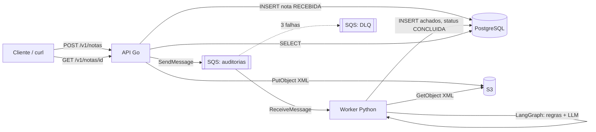
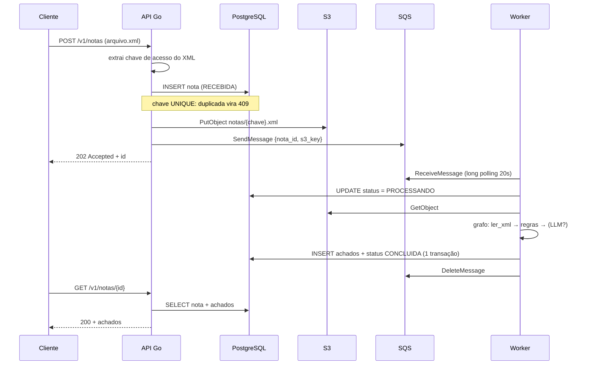
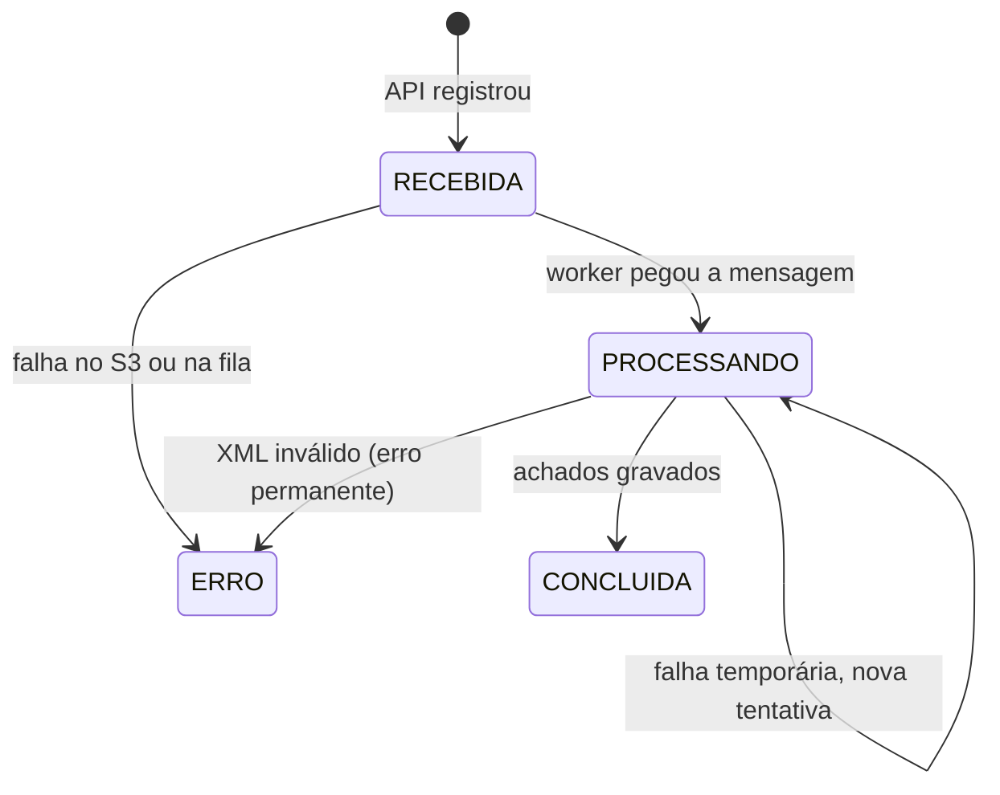

# 2. Arquitetura

## Componentes

| Componente | Responsabilidade | Não faz |
|---|---|---|
| **API Go** | validar o upload, registrar a nota, salvar no S3, enfileirar, servir consultas | regra fiscal |
| **S3** | guardar o XML original (fonte da verdade do arquivo) | — |
| **SQS** | entregar "pedidos de auditoria" ao worker, com retentativa | — |
| **DLQ** | guardar mensagens que falharam 3 vezes para análise | — |
| **Worker Python** | ler o XML, aplicar regras, chamar o LLM, gravar achados | HTTP |
| **PostgreSQL** | estado das notas e achados | guardar o XML |

## Fluxo de uma nota, passo a passo

## Estados de uma nota

## Por que assíncrono?

Se a API auditasse durante o request:
- uma chamada ao LLM pode levar de 5 a 20 s, e o cliente ficaria esperando;
- um pico de uploads derrubaria a API, porque todo o trabalho pesado
  aconteceria nela;
- uma falha do LLM viraria erro 500 para o cliente.

Com fila:
- a API responde em milissegundos (**202 Accepted**);
- o worker escala separadamente (mais réplicas = mais vazão);
- falhas temporárias são tentadas de novo automaticamente;
- o que falha sempre vai para a DLQ em vez de travar a fila.

## Ambiente local x AWS real

O código é o mesmo. Só muda a configuração (variáveis de ambiente):

| Recurso | Local (docker compose) | AWS (alvo do Terraform) |
|---|---|---|
| API | container `api` | ECS Fargate ou App Runner |
| Worker | container `worker` | ECS Fargate (serviço separado) |
| S3 / SQS | LocalStack (`AWS_ENDPOINT_URL`) | S3 / SQS reais (sem endpoint) |
| Credenciais | `test`/`test` falsas | IAM Role da task (sem chave no código) |
| Banco | container `postgres` | RDS PostgreSQL |
| LLM | Anthropic API | Anthropic API ou Amazon Bedrock |
| Logs | `docker compose logs` | CloudWatch Logs (os logs já saem em JSON) |
