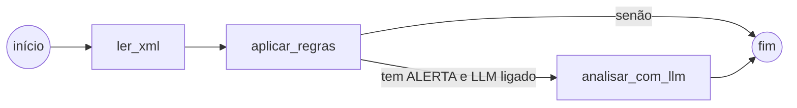

# 5. Worker, regras fiscais e LangGraph

## O loop do worker (`worker/auditor/main.py`)

```
enquanto rodando:
    mensagens = SQS.receive(espera até 20s, até 5 mensagens)
    para cada mensagem:
        processar(mensagem)
        sucesso         -> apaga da fila
        XML inválido    -> marca ERRO e apaga (tentar de novo não resolve)
        outra exceção   -> NÃO apaga (volta para a fila e é tentada de novo)
```

Conceitos importantes do SQS usados aqui:

| Conceito | O que é | Valor no projeto |
|---|---|---|
| **Long polling** | `receive` espera até chegar mensagem, em vez de voltar vazio na hora | 20 s (menos chamadas = menos custo) |
| **Visibility timeout** | após ser lida, a mensagem some por X segundos; se não for apagada, reaparece | 120 s |
| **maxReceiveCount** | quantas vezes uma mensagem pode reaparecer antes de ir para a DLQ | 3 |
| **DLQ** | fila de mensagens "mortas", para análise manual | `auditor-nfe-auditorias-dlq` |
| **At-least-once** | o SQS padrão pode entregar a mesma mensagem 2 vezes | tratado com idempotência ↓ |

### Idempotência

Como a mesma mensagem pode chegar duas vezes, o worker começa com:

```sql
UPDATE notas SET status = 'PROCESSANDO'
WHERE id = $1 AND status IN ('RECEBIDA', 'PROCESSANDO')
```

Se a nota já está `CONCLUIDA`, nenhuma linha é afetada e a mensagem é
ignorada. A gravação dos achados também apaga os anteriores antes de inserir
(dentro de uma transação), então reprocessar nunca duplica achados.

### Desligamento gracioso

O worker trata `SIGTERM` (enviado pelo Docker/ECS ao parar o container):
termina a mensagem atual e sai. Sem isso, uma nota poderia ficar pela metade.

## O grafo LangGraph (`worker/auditor/grafo.py`)



- **Estado** (`EstadoAuditoria`): um `TypedDict` com `xml`, `nota` e
  `achados`. Cada nó recebe o estado e devolve só o que mudou.
- **Aresta condicional** (`rota_apos_regras`): decide se chama o LLM. É uma
  função pura, testada em `test_rota_so_chama_llm_com_alerta_e_flag_ligada`.

**Por que LangGraph se o fluxo é pequeno?** Porque ele já está pronto para
crescer sem virar um emaranhado de `if`:
- inserir um nó de **RAG** (buscar a legislação) antes do LLM;
- usar `interrupt` para **revisão humana** quando a confiança for baixa;
- *checkpointing*: retomar um fluxo longo de onde parou.

## As regras (`worker/auditor/regras.py`)

Cada regra é uma **função pura** `NotaFiscal -> list[Achado]`: sem banco,
sem rede. Por isso são rápidas, baratas e testáveis isoladamente.

### R001: dígito verificador da chave de acesso
A chave tem 44 dígitos: UF (2), AAMM (4), CNPJ (14), modelo (2), série (3),
número (9), tipo de emissão (1), código numérico (8) e **DV (1)**. O DV é
calculado por **módulo 11** sobre os 43 primeiros dígitos, com pesos de 2 a
9 da direita para a esquerda (recomeçando em 2). Se o resto da divisão
por 11 for 0 ou 1, o DV é 0; senão, 11 − resto.

### R002: CFOP x destino da operação
O primeiro dígito do CFOP indica a abrangência:

| 1º dígito | Significado |
|---|---|
| 1 / 5 | entrada / saída **dentro do estado** |
| 2 / 6 | entrada / saída **para outro estado** |
| 3 / 7 | entrada / saída **com o exterior** |

O campo `idDest` da nota diz: 1 = interna, 2 = interestadual, 3 = exterior.
Exemplo de erro: CFOP **6102** (venda interestadual) numa nota com
`idDest = 1`.

### R003: CFOP x tipo da nota
CFOP 1/2/3 é **entrada**; 5/6/7 é **saída**. Tem que bater com `tpNF`
(0 = entrada, 1 = saída).

### R004: NCM
NCM tem 8 dígitos. Formato errado vira **ERRO**. `00000000` (genérico)
vira **ALERTA**: pode ser legítimo em casos específicos, então precisa de
análise. É exatamente o tipo de caso que vai para o LLM.

### R005: soma dos itens
`Σ det/prod/vProd` deve ser igual a `total/ICMSTot/vProd`. Valores sempre em
`Decimal`, nunca `float` (em float, `0.1 + 0.2 = 0.30000000000000004`).
Há um teste para isso.

### R006: CNPJ do emitente
Dois dígitos verificadores, módulo 11 com pesos 2 a 9 (mesma função da
R001). CNPJs com todos os dígitos iguais (`11111111111111`) passam no cálculo,
mas são inválidos, então também são rejeitados.

### ERRO x ALERTA x INFO

| Severidade | Significado | Quem gera |
|---|---|---|
| ERRO | violação objetiva, a nota está errada | só regras |
| ALERTA | suspeito, precisa de olho humano | regras e LLM |
| INFO | observação complementar | LLM |

**O LLM nunca gera ERRO.** Decisão fiscal objetiva fica no código
determinístico, testável e auditável. O LLM ajuda a explicar e priorizar.

### Como adicionar uma regra
1. Escreva a função em `regras.py` (recebe `NotaFiscal`, devolve
   `list[Achado]`).
2. Adicione-a na lista `REGRAS`.
3. Escreva o teste em `tests/test_regras.py`.
4. Se precisar de um campo novo do XML, adicione-o em `nfe.py`.

## Leitura segura do XML (`worker/auditor/nfe.py`)

Usamos **`defusedxml`**. XML de fonte externa pode trazer:
- **XXE** (*XML External Entity*): `<!ENTITY x SYSTEM "file:///etc/passwd">`
  faria o parser ler arquivos do servidor;
- **Billion laughs**: entidades aninhadas que se expandem até esgotar a
  memória.

O teste `test_xml_com_entidade_externa_e_bloqueado` prova a proteção.

## O LLM (`worker/auditor/llm.py`)

- **Desligado por padrão** (`LLM_HABILITADO=false`): o projeto roda e os
  testes passam sem chave e sem custo.
- **Saída estruturada**: `with_structured_output(RespostaAnalise)` faz o
  modelo responder num JSON validado por Pydantic. Nada de "parsear" texto
  livre com regex.
- **`temperature=0`**: auditoria pede respostas estáveis, não criativas.
- **Só recebe os ALERTAS**: menos tokens, menos custo, menos chance de o
  modelo "inventar" problemas.
- **Próximo passo**: um nó de RAG que busca o trecho da legislação (RICMS,
  tabela NCM) e o inclui no prompt, para a resposta citar a fonte.
